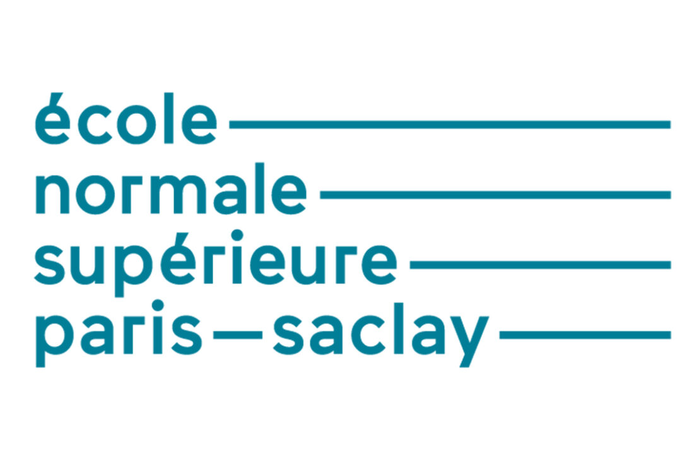

<p align="center">
  
  &nbsp;&nbsp;&nbsp;&nbsp;
  
  &nbsp;&nbsp;&nbsp;&nbsp;
  
</p>

<h1 align="center">Advanced Learning for Text and Graph Data</h1>

<p align="center">
  
  
  
  
  
</p>

Lab work for the **Advanced Learning for Text and Graph Data (ALTeGraD)** course of the
**MVA Master (Mathématiques, Vision, Apprentissage)**, Université Paris-Saclay, Fall 2026.
Lectures by Prof. Michalis Vazirgiannis.

Each notebook contains the completed code, the outputs of my runs and my written answers to the questions.
All notebooks run on a free Google Colab T4 GPU.

| Lab | Topic | Notebook |
|---|---|---|
| 1 | Neural machine translation with attention (seq2seq) | [](https://colab.research.google.com/github/<your-username>/Advanced-Learning-for-Text-and-Graph-Data/blob/main/lab1/Lab1_Osias_Stave.ipynb) |
| 2 | Supervised finetuning with QLoRA, and tool calling | [](https://colab.research.google.com/github/<your-username>/Advanced-Learning-for-Text-and-Graph-Data/blob/main/lab2/Lab2_Osias_Stave.ipynb) |
| 3 | Post-training with DPO and GRPO | [](https://colab.research.google.com/github/<your-username>/Advanced-Learning-for-Text-and-Graph-Data/blob/main/lab3/Lab3_Osias_Stave.ipynb) |

---

## Lab 1: Neural Machine Translation with Attention

English → French translation with a GRU encoder–decoder and Luong's global (concat) attention, implemented in PyTorch.

- Implemented the encoder, the decoder and the attention mechanism, and trained the model (test loss 4.70 → 2.84 over 20 epochs).
- Visualized source/target alignments as attention heatmaps.
- Analyzed greedy decoding with the top-5 next-word probabilities: near-ties settled too early and self-reinforcing repetitions.
- **Found and fixed a train/test mismatch:** training sources end with `<EOS>`, but the prediction code did not add it. With the fix, the share of translations that terminate went from 2/13 to 13/13.
- Studied the coverage problem (over- and under-translation) and contextual word sense (*mean* = intend vs unkind).

**Concepts:** embeddings, GRUs, attention as soft alignment, greedy vs beam search, coverage, contextual representations (ELMo, BERT).

## Lab 2: Supervised Finetuning with QLoRA, and Tool Calling

Turning the base model **Qwen3.5-0.8B-Base** into an assistant with parameter-efficient finetuning (Hugging Face `transformers` and `peft`, `bitsandbytes`).

- Loaded the model in 4-bit NF4 with double quantization and added LoRA adapters to all linear layers of its hybrid architecture (full attention, Gated DeltaNet and MLP): 21.6M trainable parameters out of 774M.
- **French summarization** (OrangeSum) with completion-only training (prompt tokens masked with −100): held-out loss 2.331 → 2.164.
- **Tool calling** (Glaive function-calling data): before finetuning, the model invented weather values and did not stop. After finetuning, it emitted a valid `<call>`, stopped, and answered from the real tool result.
- Computed the training memory with and without LoRA (≈ 9.0 GB vs ≈ 1.8 GB for weights, gradients and Adam states).

**Concepts:** quantization (storage vs compute dtype, double quantization), LoRA, temperature and nucleus sampling, gradient accumulation, data collators, label masking.

## Lab 3: Post-Training with DPO and GRPO

Aligning **Qwen3-0.6B** with preferences and improving it with reinforcement learning (Hugging Face `trl`, Weights & Biases).

- **DPO** on French preference pairs (Orca DPO): pair accuracy 75% → 97%. The implicit reward of the *chosen* answers decreased (−0.29 → −2.74): DPO separated the pairs mainly by pushing the rejected answers down.
- **GRPO** on GSM8K with rule-based rewards (format + correctness). **Accuracy on 200 test problems went from 10.0% to 44.5%.** The model learned to reason before answering: answers became 5× longer, format compliance went from 18% to 88%, and accuracy among well-formatted answers went from 33% to 51%.
- Measured the limits of sparse rewards: 58% of the GRPO groups had two equal rewards and gave no learning signal.

**Concepts:** KL-regularized reward maximization, DPO as its closed-form solution, group-relative advantages, PPO clipping, reward hacking, the role of the reference model, sparse vs dense rewards.

---

## Repository structure

```
Advanced-Learning-for-Text-and-Graph-Data/
├── README.md
├── assets/            # logos shown at the top of this page
├── lab1/Lab1_Osias_Stave.ipynb
├── lab2/Lab2_Osias_Stave.ipynb
└── lab3/Lab3_Osias_Stave.ipynb
```

Models, adapters and datasets are not included. They are downloaded or regenerated when the notebooks run.

## Author

**Stave Icnel Dany Osias**, MVA Master student, Université Paris-Saclay